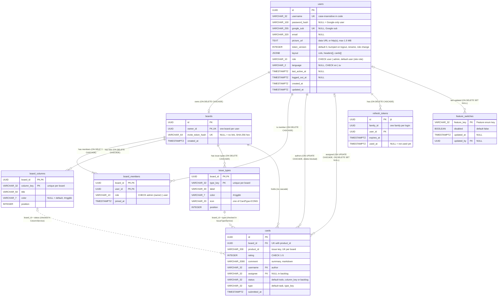

# Database diagram

PostgreSQL schema of `server-java`, as built by the Flyway migrations `V1`–`V13` in
`server-java/src/main/resources/db/migration/`. Update this file when a migration changes tables,
keys, indexes or `CHECK` constraints.

- Solid lines are real foreign keys.
- Dotted lines are references checked only in code (no FK in the database).
- Columns are `NOT NULL` unless marked `NULL`. `CHECK` = enforced by the database;
  `default` = column default.

## Notes

- `boards.owner_id` is `NOT NULL UNIQUE`, so the database allows a user without a board; the code
  always creates one (`BoardService.createFor` on register and first Google sign-in), and the owner
  is always a `board_members` row with role `admin`.
- `cards.username` and `cards.assignee` reference `users.username`, not `users.id`, so a rename
  follows through `ON UPDATE CASCADE` (`V5`). A user who still authors cards cannot be deleted.
- `cards.board_id` has no cascade: a board with cards blocks deleting its owner.
- `cards.status` is a `board_columns.column_key` on the same board (`board_id` + `status`), or
  `backlog` (not a list). `cards.type` is an `issue_types.type_key` on the same board
  (`board_id` + `type`). Neither is a foreign key; the services check them on create and update,
  and lists/types in use cannot be deleted (`409`).
- `refresh_tokens.family_id` groups the tokens of one login; it is not a foreign key.
- `users.layout` is embedded JSON (card order per list, keyed by card id), not a separate table.
- `flyway_schema_history` (Flyway's own table) is left out.

## Indexes

Besides primary keys and `UNIQUE` constraints:

| Index | Columns | Used for |
| --- | --- | --- |
| `cards_board_submitted_at_idx` | `cards (board_id, submitted_at DESC)` | a board's cards, newest first |
| `board_members_user_idx` | `board_members (user_id)` | the boards a user belongs to |
| `refresh_tokens_family_idx` | `refresh_tokens (family_id)` | deleting a family on token reuse |
| `refresh_tokens_user_expires_idx` | `refresh_tokens (user_id, expires_at)` | a user's live tokens |

## Seed data

The migrations insert rows, not only tables:

- `board_columns` and `issue_types`: every board existing at `V11` gets the defaults — lists
  `todo`, `in-progress`, `test`, `done`; issue types `task`, `bug`, `doc`. New boards get them from
  `BoardService.createFor` (`CardStatus.DEFAULT_COLUMNS`, `CardType.DEFAULTS`).
- `feature_switches`: one row per `Feature` enum key, all on (`V12`).
