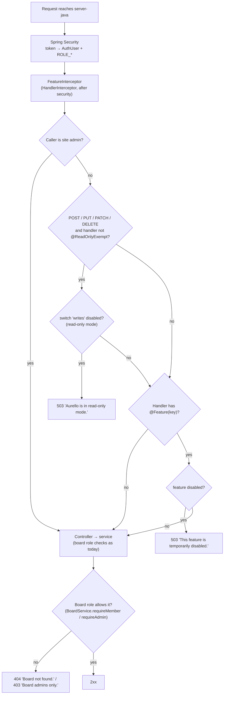
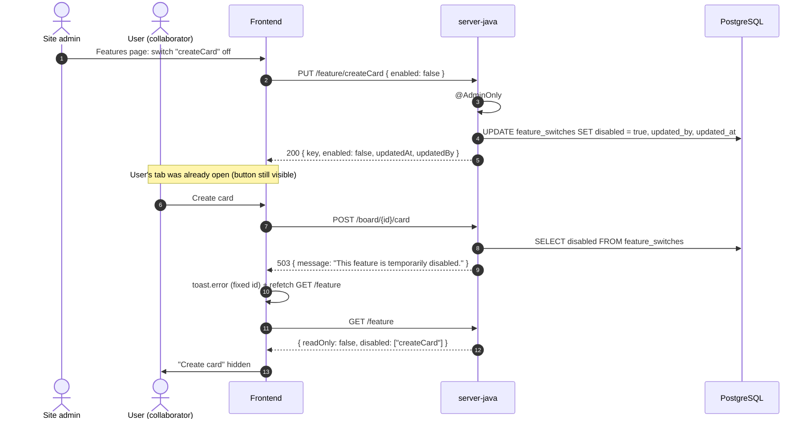
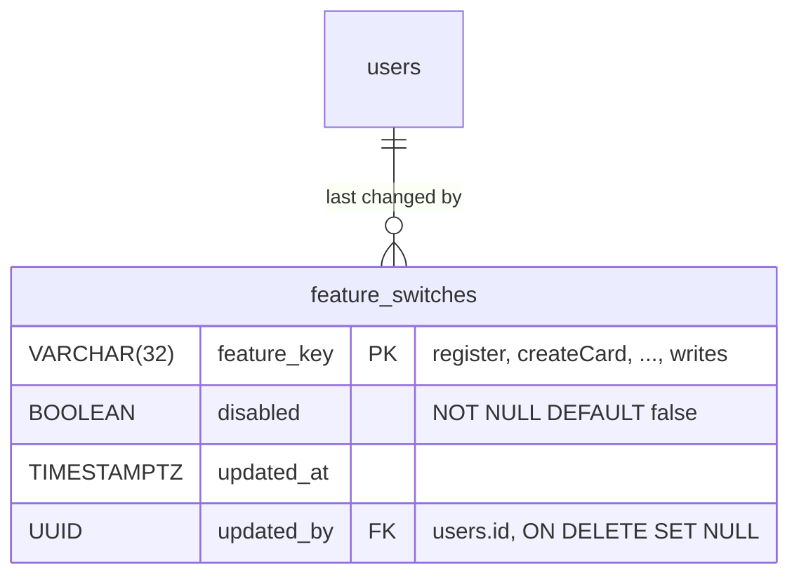
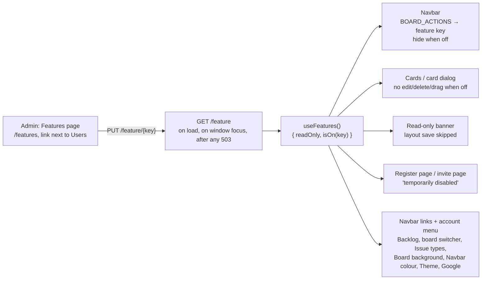

# Feature switches and read-only mode (plan)

Status: **planned, not implemented**. Agreed 2026-11-17.

A site admin can switch individual features off for everyone else, or put the whole site in read-only mode. The **backend refuses** the request (`503`). The frontend only hides the buttons to match. Hiding a button is never the protection.

Used for maintenance, for stopping abuse ("hacker issues"), and for limiting what users can do.

A second, smaller group of **navbar switches** only hides navbar links and account-menu settings (section 2.1). They are UI-only by design and are labelled that way on the admin page; they are not a security control.

## 1. Decisions

| Question | Decision |
|---|---|
| Role or setting? | A setting. No new role: a user has one role, and a role can't express "these buttons". |
| Which backend? | **`server-java` only** (like Google sign-in). `server/` (Express) doesn't get it; it is listed as a known difference. |
| Status code when blocked | **`503`**: `"This feature is temporarily disabled."` / `"Aurello is in read-only mode."` (503 doesn't trigger the frontend's 401 refresh) |
| Who is exempt | The **site admin** (`User.role = admin`) is never blocked and always sees every button |
| Scope | Whole site for now. The table is built so a per-board switch can be added later (nullable `board_id`) |
| Rule | **Allowed = board role allows it AND the feature is on** (site admins skip the second part). A switch only takes rights away, never grants them |
| Read-only mode | Yes: one master switch that blocks every write for non-admins |
| Navbar switches | **UI-only** (hide, never `503`): they cover pages that only read (`GET`) and settings saved in the browser, so there is nothing for the backend to refuse and reads stay free. Labelled "Hides only" on the Features page. Exception: `googleConnect` is a write and is enforced like the others |

## 2. The switches

| Key | Hides in the UI | Blocks (503) |
|---|---|---|
| `register` | "Register User" link, register page shows a message | `POST /auth/register`; a **first** Google sign-in that would create a user |
| `createCard` | "Create card" (navbar second row) | `POST /board/{id}/card` |
| `editCard` | Edit in the card dialog, dragging a card to another list | `PUT /board/{id}/card/{cardId}`, `PATCH …/card/{cardId}/status` |
| `deleteCard` | Delete in the card dialog | `DELETE /board/{id}/card/{cardId}` |
| `createColumn` | "Create column" (navbar second row) | `POST /board/{id}/column` |
| `deleteColumn` | "Delete column" (navbar second row) | `DELETE /board/{id}/column/{key}` |
| `editColumns` | Rename/recolour in the list header, dragging list headers | `PUT /board/{id}/column/{key}`, `PUT /board/{id}/column` (move) |
| `manageIssueTypes` | "Create Issue type", delete on the Issue types page | `POST`, `DELETE /{key}` on `/board/{id}/issue-type` |
| `shareBoard` | "Share" / "Members" (navbar second row) | `POST`/`DELETE /board/{id}/invite`, `DELETE /board/{id}/member/{userId}` (this also blocks **leaving** a board) |
| `joinBoard` | Invite page shows "temporarily disabled" | `POST /invite/{token}` (stops leaked invite links without touching member management) |
| `googleConnect` | "Google sign-in" in the account menu | `POST /user/google` (connecting Google to a password account; signing in with an already connected Google account is not affected) |
| `writes` (API: `readOnly`) | Read-only banner, all create/edit/delete/drag off | Every `POST`/`PUT`/`PATCH`/`DELETE` except the exempt ones below |

`editCard` covers moving cards. If moving should be frozen separately later, split it out as `moveCard`.

Each button in the navbar's second row has its own switch: `createCard`, `createColumn`, `deleteColumn`, `shareBoard` (one-to-one with `BOARD_ACTIONS`; "Create Issue type" on the Issue types page is `manageIssueTypes`). They are enforced like every switch in this table, since each one is a write. The Features page shows them together as a "Navbar second row" group. Lists used to be one `manageColumns` switch; it is split so that, for example, deleting lists can be stopped while creating them still works.

### 2.1 Navbar switches (UI-only)

| Key | Hides | What still works (by design) |
|---|---|---|
| `backlogPage` | "Backlog" link; `/backlog` shows "This page is turned off" with a link to the board; the "Backlog" choice in the card form's list select (so cards don't vanish from view) | `GET /board/{id}/card` (the board reads the same list); cards already in the backlog stay there |
| `boardSwitcher` | The board dropdown (desktop: left of the account button; mobile: in the hamburger menu, after Issue types; only shown with more than one board) | The Board link; the board last chosen in this browser stays shown; accepting an invite still opens the new board (`showJoinedBoard`); picking a board never changed the page anyway |
| `issueTypesPage` | "Issue types" link for board owners; `/issue-types` shows "This page is turned off" | Creating a type from the card form (that is `manageIssueTypes`) |
| `boardBackground` | "Board background" in the account menu | The background already saved in the browser keeps applying |
| `navbarColour` | "Navbar colour" in the account menu | The navbar colour already saved keeps applying |
| `theme` | "Theme" in the account menu (after the dark-mode branch is merged) | The theme already saved keeps applying |

- The account menu opens from the account button: desktop at the right end of the navbar (icon + initials), mobile at the right of the top bar (icon only; the bar is hamburger left, AURELLO centred, account right). The hamburger menu uses the navbar's colours. Hidden account-menu items are hidden in both.
- Read-only mode does **not** touch these (they are not writes); site admins always see everything, as with the other switches.
- Saved browser choices are left alone on purpose: switching a picker off must not change how anyone's board looks. If a uniform look is wanted later, add "reset to default while off" as a separate decision.
- Anyone can still call the API or set `localStorage` by hand. That is accepted: these switches tidy the UI, they don't protect anything.

### Never switchable (and exempt from read-only mode)

- `POST /auth/login`, `/auth/refresh`, `/auth/logout`: otherwise users get logged out instead of just blocked.
- `POST /auth/google` for **existing** users. Creating a new user through it is blocked by `register` and by read-only mode.
- All `GET` endpoints.
- `GET /health`.
- Admin endpoints (`/user/{id}` `PATCH`/`DELETE`/`logout`, `PUT /feature/{key}`): admins are exempt anyway, so these still work during an incident.

`PUT /user/layout` (card order) has no switch of its own; read-only mode blocks it, and the frontend stops saving the layout while read-only.

## 3. How a request is checked

- Only write requests and `@Feature` handlers read the switches. **Plain `GET`s cost nothing extra.**
- Switches are read from the database on every checked request (one small query, or a cache of a few seconds at most). No long in-memory cache: it would be wrong as soon as more than one Fly machine runs, and a kill switch must take effect immediately.
- Admin status comes from the access token (`ROLE_ADMIN`), like `@AdminOnly`. A demoted admin keeps the exemption until their access token expires (≤ 15 min).

## 4. Turning a switch off and what users see

## 5. Data model (Flyway `V12__feature_switches.sql`, needs approval)

- One row per switch, seeded by the migration with `disabled = false`. A missing row reads as "on", so adding a key later never blocks anything by accident.
- Read-only mode is the row `writes` with `disabled = true` ("writes are disabled"). The API exposes it as `readOnly`.
- Navbar switches are ordinary rows in the same table (seeded by V12 too); only the backend's `Feature` enum knows they are UI-only.
- `updated_by` / `updated_at` record who changed what and when; this matters after an incident.
- Later, per board: add a nullable `board_id` (FK → `boards`, cascade) and change the PK. No redesign needed.

## 6. API (server-java only)

| Method + path | Who | Returns |
|---|---|---|
| `GET /feature` | **Public** (`permitAll`; the register page needs it before login). An optional token still authenticates | `{ readOnly, disabled: [keys] }`; for site admins also `switches: [{ key, enabled, updatedAt, updatedBy }]` (the same pattern as `GET /user` adding fields for admins) |
| `PUT /feature/{key}` | `@AdminOnly` | Body `{ enabled: boolean }` → the updated switch. Unknown key → `404`. `key` = one of the 11 features, the 6 navbar switches or `readOnly` |

## 7. Backend parts

| Part | Where |
|---|---|
| `Feature` enum (18 keys incl. `WRITES`, JSON keys as in the tables; a `uiOnly` flag on the 6 navbar switches) | `entity/Feature.java` |
| `FeatureSwitch` entity + repository | `entity/`, `repository/` |
| `FeatureService`: `isDisabled(key)`, `readOnly()`, `list()`, `set(key, enabled, adminId)` | `service/` |
| `@Feature(Feature.X)` and `@ReadOnlyExempt` annotations | `security/` |
| `FeatureInterceptor` (flowchart above), registered in a `WebMvcConfigurer` | `security/` or `config/` |
| `ApiException.serviceUnavailable(...)` → 503 `{ message }` | `exception/` |
| `FeatureController` (`GET /feature`, `PUT /feature/{key}`) | `controller/` |
| `SecurityConfig`: permit `GET /feature` | `config/` |
| Google sign-in: check `register` + read-only before **creating** a user | `AuthService` / Google path |

## 8. Frontend parts

- `app/utils/features.ts`: `FEATURE_KEYS` (must match the Java `Feature` enum), `NAVBAR_FEATURE_KEYS` (the UI-only ones), the `BOARD_ACTIONS` → feature map (`createCard`, `createColumn`, `deleteColumn`, `shareBoard`, `createIssueType` → `manageIssueTypes`), and pure helpers (unit-tested).
- Navbar: `Navbar.tsx` hides Backlog, the board switcher and Issue types (the Board link is always shown, so the board stays reachable); `AccountMenu.tsx` hides its items (and the whole "Aurello" section when all three appearance switches are off). `/backlog` and `/issue-types` show "This page is turned off" instead of their content.
- `useFeatures()`: site admins get everything on (`isOn` is always true), but the admin page still shows the real state.
- `api.ts`: a `503` shows `toast.error(apiErrorMessage(...))` with a fixed `id` and triggers a refetch of `/feature`.
- `endpoints.ts` + `tests/unit/endpoints.test.ts`: `getFeatures`, `setFeature`.
- If `GET /feature` fails (for example an old backend without it), treat everything as on. Never block the UI because the switch list couldn't load.
- Admin page `app/features/page.tsx`: one toggle per switch with "changed by … at …". Read-only mode is at the top, styled as a danger toggle, with an `AlertDialog` confirmation. The navbar switches are their own group at the bottom with a "Hides only" label and a one-line note that they are not a security control.
- Mockup: `docs/feature-switches-ui.html` (open in a browser).

## 9. Tests

- **`FeatureApiTest`** (Testcontainers): for each switch, the blocked endpoints return 503 for a user and work for a site admin; the board role still applies when a switch is on; read-only mode blocks every write but `login`/`refresh`/`logout` keep working; Google sign-in creates no user while `register` is off.
- **`FeatureCoverageTest`** (like `AdminOnlyApiTest`): lists exactly which handler methods carry `@Feature` and `@ReadOnlyExempt`, so a new endpoint can't silently miss them, and checks that no handler carries a `uiOnly` feature.
- `FeatureApiTest`: `googleConnect` off → `POST /user/google` 503; a navbar switch off → `GET /feature` lists it, but every `GET` still answers 200.
- `AdminOnlyApiTest`: add `PUT /feature/{key}`.
- Frontend unit tests: `features.ts` helpers and the `endpoints.test.ts` paths.

## 10. Build order (one branch `feature/feature-switches`, small commits)

1. `feat:` V12 migration + entity, repository, `Feature` enum, `FeatureService`
2. `feat:` interceptor + annotations + 503 + `FeatureController` + tests
3. `feat:` frontend `features.ts`, `useFeatures`, endpoints, 503 handling
4. `feat:` hide navbar buttons and card actions, read-only banner, register/invite messages, navbar switches (links, account menu, "page turned off")
5. `feat:` admin Features page
6. `docs:` `CLAUDE.md`, `server-java/README.md` (known difference: Java only), `docs/backend-map.html`

**Deploy order:** `server-java` first (`fly deploy -c fly.java.toml`), then merge the frontend. The frontend copes with a missing `/feature`, so the order is safe either way.

## 11. Before starting

- [ ] Approve the schema change (`V12__feature_switches.sql`, section 5)
- [ ] Confirm the Features page lives at `/features` with a navbar link next to Users
