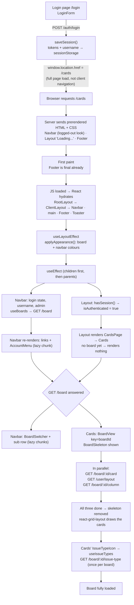
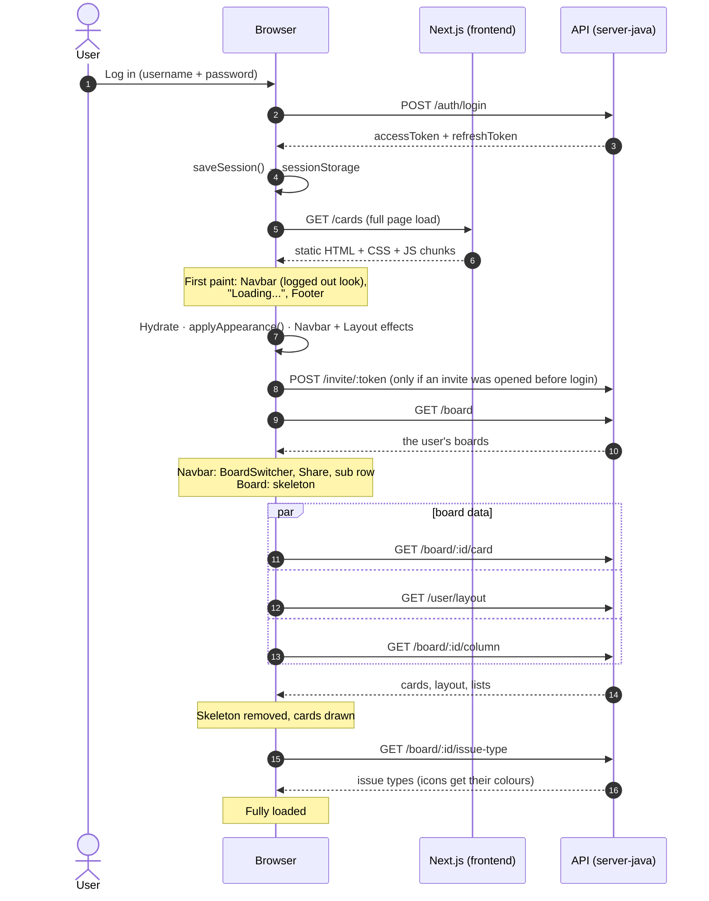
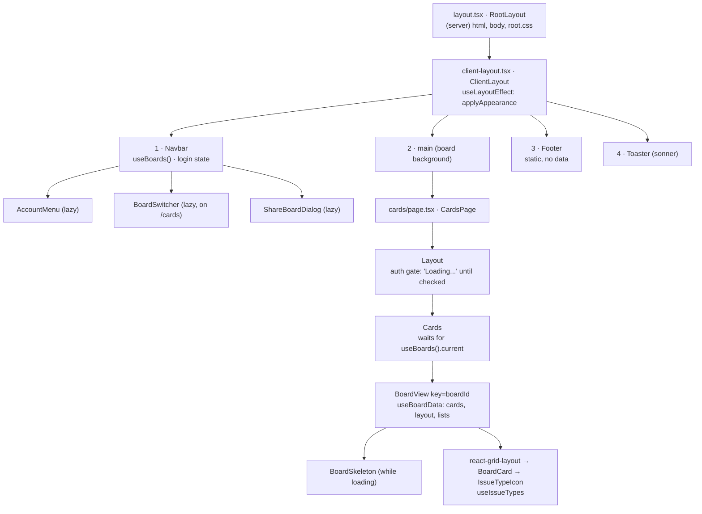

# From login to a fully loaded board

What happens, in order, from pressing **Log in** until the board shows its cards (`/cards`). Paths are in `frontend/app/`.

## 1. Overview

## 2. Timeline (who talks to whom)

## 3. Component tree and render order

React renders **top to bottom** (Navbar → main → Footer). Effects run **children first**, then parents, siblings in order.

## 4. When each part is ready

| Step | Navbar | Main (CardsPage) | Footer |
|---|---|---|---|
| HTML arrives (first paint) | Logo only, logged-out look, default colours | "Loading..." (Layout) | **Final** |
| Hydration + layout effect | Saved navbar colours applied | Saved board background applied | — |
| Effects run | Links, username, admin; AccountMenu chunk loads | Auth OK → Cards, nothing shown yet (no board) | — |
| `GET /board` done | BoardSwitcher, Share, sub row (Create card …) | BoardView + skeleton | — |
| Cards, layout, lists done | — | Cards drawn in their lists | — |
| Issue types done | — | Icons in the right colours | — |

## Notes

- **Full reload after login**: `window.location.href` (not `router.push`) makes the browser fetch `/cards` again, so the navbar, `useBoards` and the axios instance all start fresh with the new session.
- **Footer** has no state or data, so it is final in the first HTML.
- **Navbar** is prerendered as logged out (the server can't read `sessionStorage`) and switches to logged in after its first effect.
- **`useBoards`** is shared: the Navbar's effect starts `GET /board`; `Cards` calls the same hook, finds the request in flight and waits for the same answer.
- **Expired access token**: any request that gets `401` goes through the axios interceptor in `api/api.ts` (`POST /auth/refresh`, then retry), which adds one round trip at that step.
- **Board switch** (navbar): only `BoardView` remounts (`key={boardId}`) and refetches cards, lists and issue types; the layout request runs again too, Navbar and Footer stay.
