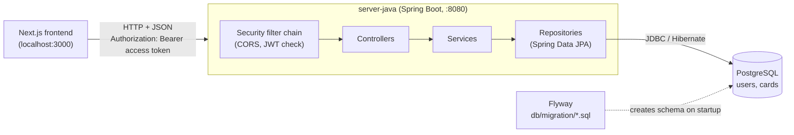
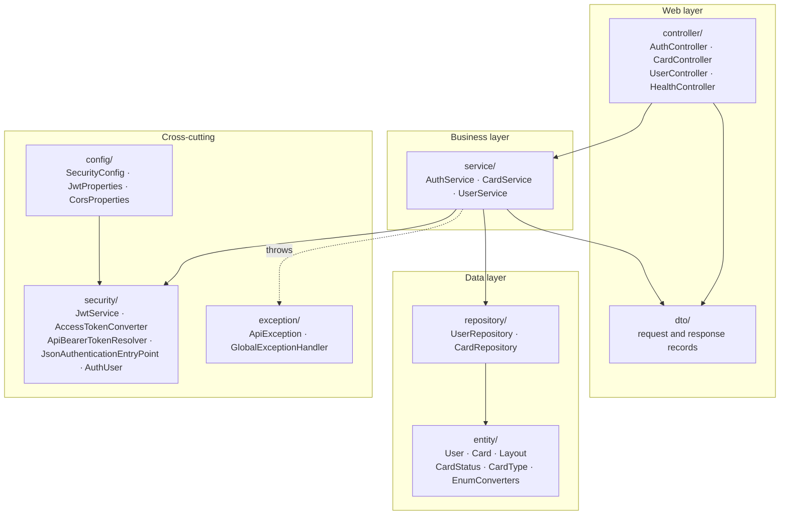
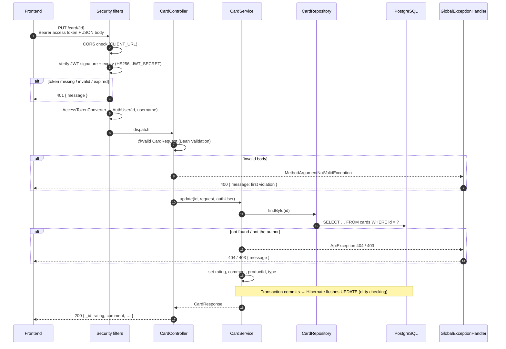
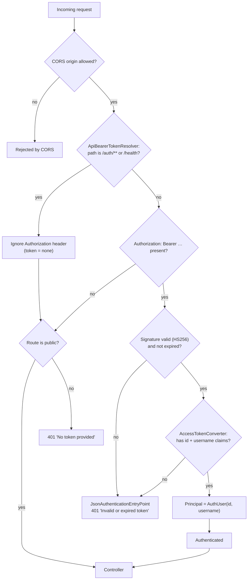
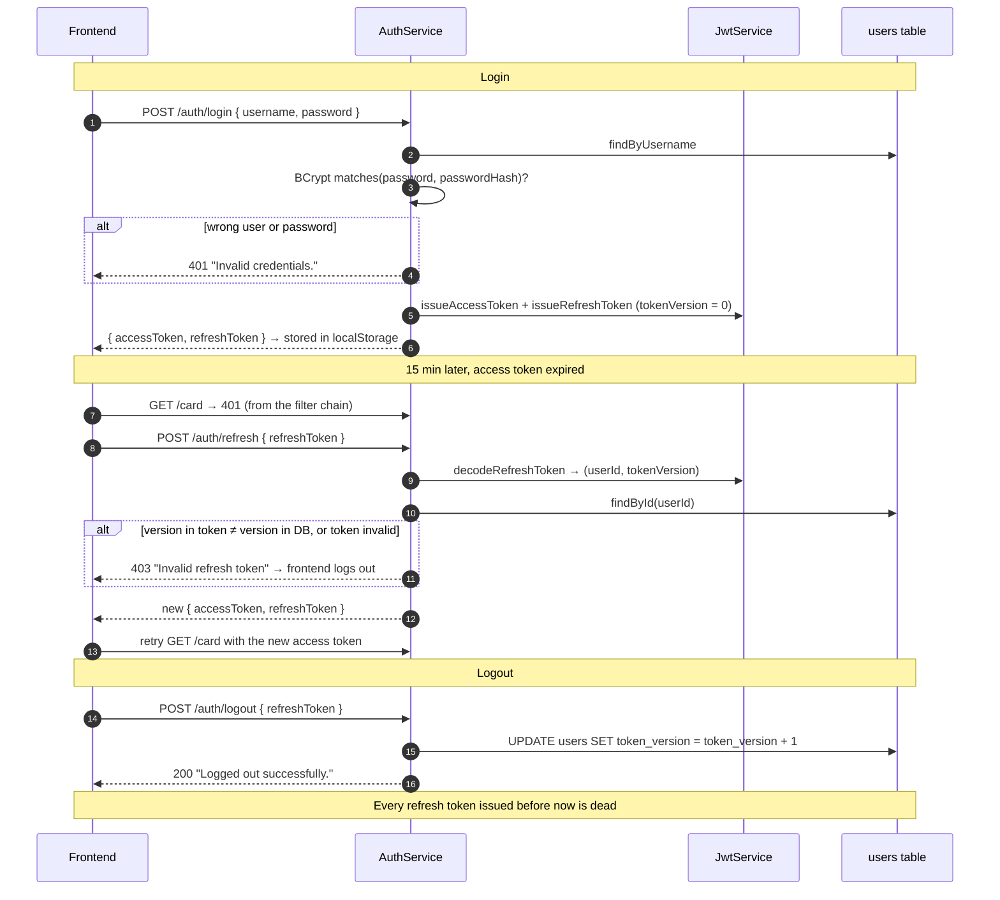
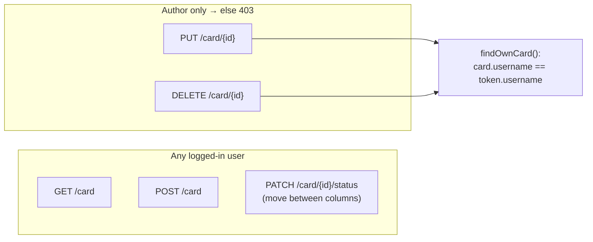
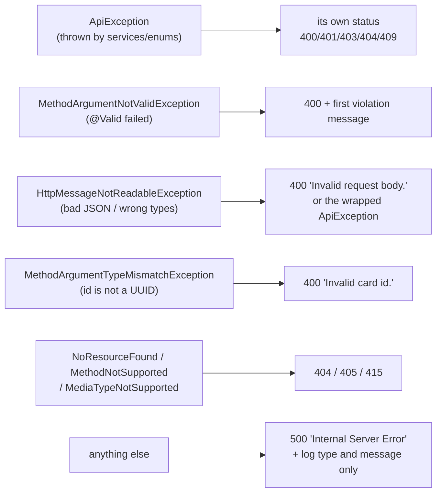
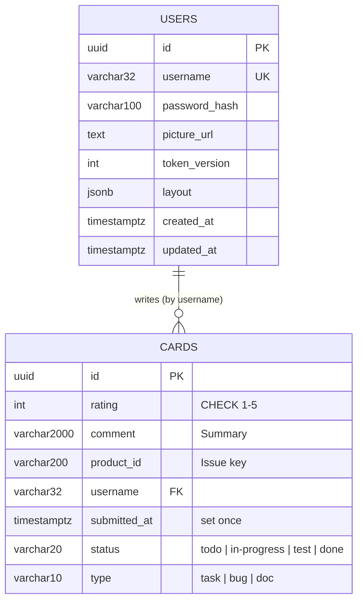
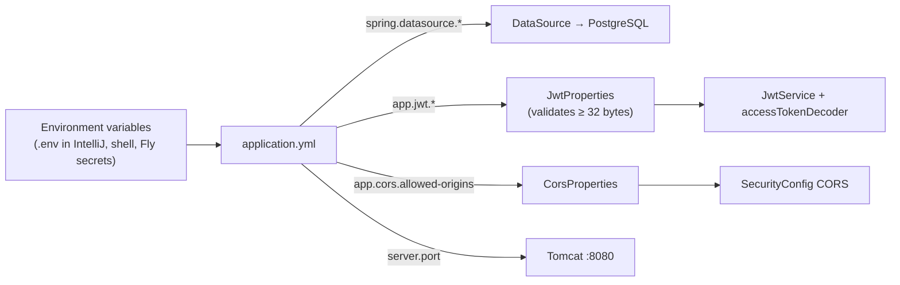
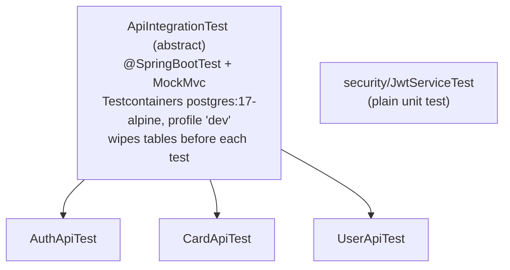

# server-java — Architecture

A walkthrough of the Spring Boot + PostgreSQL API in `server-java/`: how a request travels through the code, what each package does, how authentication works, and how the data is stored. For setup and running, see [README.md](README.md).

The API is a port of the Express API in `server/` and must stay compatible with it: same paths, same `{ message }` error bodies, same status codes, same token rules. The frontend can switch between the two by changing `NEXT_PUBLIC_API_URL`.

---

## 1. The big picture



| Piece | Technology |
|---|---|
| Runtime | Java 25, Spring Boot 4.1 |
| Web | Spring MVC (`@RestController`) |
| Security | Spring Security as an OAuth2 *resource server*, HS256 JWTs via Nimbus |
| Persistence | Spring Data JPA / Hibernate, PostgreSQL |
| Schema | Flyway migrations (Hibernate only *validates*) |
| Validation | Bean Validation (`@NotBlank`, `@Size`, …) on request records |
| Tests | JUnit 5, MockMvc, Testcontainers (real Postgres in Docker) |

---

## 2. Package layout

Everything lives under `src/main/java/se/aurell/jiraboard/`.



| Package | Responsibility | Rule of thumb |
|---|---|---|
| `controller/` | Maps HTTP to Java. Validates the body (`@Valid`), gets the logged-in user (`@AuthenticationPrincipal AuthUser`), calls a service. | Thin: no business logic, no `ResponseEntity` building. |
| `service/` | Business rules: ownership checks, password hashing, token issuing. Owns transactions (`@Transactional`, reads use `readOnly = true`). | Expected errors are thrown as `ApiException`. |
| `repository/` | Spring Data interfaces; queries are derived from method names or written in JPQL. | No logic. |
| `entity/` | JPA entities mapped to the tables, plus enums and the `Layout` JSON value. | Mirrors `V1__init.sql`. |
| `dto/` | Java `record`s for request and response bodies. Validation annotations and their messages live here. | Messages match the Express API word for word. |
| `security/` | Everything JWT: encode/decode, turn a token into a user, 401 responses. | |
| `config/` | Spring beans and typed config (`application.yml` → records). | |
| `exception/` | One exception type for expected errors, one handler that turns every error into `{ message }`. | |

`JiraboardApplication` is the entry point. `@ConfigurationPropertiesScan` makes Spring bind `JwtProperties` and `CorsProperties` from `application.yml`.

---

## 3. Life of a request

Example: the frontend calls `PUT /card/{id}` to edit a card.



Two things worth noticing:

- **No explicit `save()` on update.** The card is loaded inside a `@Transactional` method, so Hibernate tracks changes and writes them when the transaction commits.
- **Identity always comes from the token.** The author of a card and the user whose layout is changed come from `AuthUser`, never from a field in the body.

---

## 4. Endpoints

| Method | Path | Auth | Controller → Service | Success |
|---|---|---|---|---|
| `POST` | `/auth/register` | public | `AuthService.register` | `201 { message }` |
| `POST` | `/auth/login` | public | `AuthService.login` | `200 { accessToken, refreshToken }` |
| `POST` | `/auth/refresh` | public (refresh token in body) | `AuthService.refresh` | `200 { accessToken, refreshToken }` |
| `POST` | `/auth/logout` | public (refresh token in body) | `AuthService.logout` | `200 { message }` |
| `GET` | `/health` | public | `HealthController` | `200 { status: "ok" }` |
| `GET` | `/card` | token | `CardService.getAll` | `200 [card…]` newest first |
| `POST` | `/card` | token | `CardService.create` | `201 { message }` |
| `PUT` | `/card/{id}` | token, **author only** | `CardService.update` | `200 card` |
| `PATCH` | `/card/{id}/status` | token, any user | `CardService.updateStatus` | `200 card` |
| `DELETE` | `/card/{id}` | token, **author only** | `CardService.delete` | `200 { message }` |
| `GET` | `/user` | token | `UserService.getAll` | `200 [{ _id, username, pictureUrl }]` |
| `GET` | `/user/usernames` | token | `UserService.getUsernames` | `200 ["alice", …]` |
| `GET` | `/user/layout` | token | `UserService.getLayout` | `200 layout` |
| `PUT` | `/user/layout` | token | `UserService.updateLayout` | `200 { message }` |

---

## 5. Security

### 5.1 The filter chain

`config/SecurityConfig` builds one stateless filter chain:

- **No sessions, no cookies.** That is why CSRF, form login, HTTP Basic and logout are all disabled.
- **CORS** allows only the origins in `CLIENT_URL`, comma-separated.
- **Public:** `/auth/**`, `/health`, `/error`. **Everything else** needs a valid access token.
- **Resource server:** Spring's built-in Bearer token filter verifies the JWT with the access secret.



Why each class exists:

| Class | Why |
|---|---|
| `ApiBearerTokenResolver` | The frontend sends its (maybe expired) access token on *every* request, including `/auth/logout` and `/auth/refresh`. Without this, Spring would reject those calls with 401 before they reach the controller. |
| `AccessTokenConverter` | Turns the verified JWT into an `AuthUser` record, the Java version of `req.user` in Express. It also rejects refresh tokens used as access tokens: they have no `username` claim. |
| `JsonAuthenticationEntryPoint` | Makes 401s look like the rest of the API (`{ message }`) instead of Spring's default empty body. The frontend refreshes its token on any 401. |
| `AuthUser` | The logged-in user. Controllers get it with `@AuthenticationPrincipal AuthUser user`. |

### 5.2 Tokens

`security/JwtService` creates and checks two kinds of HS256 tokens with separate secrets:

| Token | Secret | Lifetime | Claims | Used for |
|---|---|---|---|---|
| Access | `JWT_SECRET` | 15 min | `id`, `username` | `Authorization: Bearer` on every protected call |
| Refresh | `REFRESH_SECRET` | 7 days | `id`, `tokenVersion` | `POST /auth/refresh` to get a new pair |

`JwtProperties` refuses to start the app if a secret is missing or shorter than 32 bytes, because HS256 needs a key of at least 256 bits.

**Revocation with `tokenVersion`:** each user row has a `token_version` counter, and every refresh token carries the version it was issued with. Logout increments the counter atomically (`UserRepository.incrementTokenVersion`), which makes all refresh tokens issued before it invalid. Access tokens aren't revoked; they simply expire within 15 minutes.



### 5.3 Passwords

- Hashed with BCrypt, strength 10, the same as the Express API. Hashes are interchangeable, so users migrated from MongoDB can log in unchanged.
- Length is 6–72 characters (`@Size`), **and** at most 72 bytes (checked in `AuthService`), because BCrypt silently ignores anything after byte 72.
- Login returns the same `401 "Invalid credentials."` for an unknown user and for a wrong password, so the response doesn't reveal which usernames exist.

---

## 6. Business rules (services)

### AuthService

- `register`: checks the password byte length and the picture (empty → default picture; otherwise a `data:image/…;base64,` or `http(s)://` URL, at most 1.5 MB). Checks that the username is free (`409`). Saves with a BCrypt hash. A unique-constraint violation from a concurrent registration is also turned into `409`.
- `login`, `refresh`, `logout`: see 5.2. `logout` never fails; an invalid or missing refresh token simply means there's nothing to revoke.

### CardService



- `create`: the author (`username`) comes from the token, and `submittedAt` is always *now*. `type` defaults to `task`. `status` is optional and lets the board create a card directly in a column.
- `update`: author only. Changes `rating`, `comment`, `productId` and `type`; never the author, date or status.
- `updateStatus`: any user may move any card, like in Jira. The board is shared.
- `delete`: author only.

### UserService

- `getAll` uses a JPQL *constructor projection* (`select new …UserResponse(…)`), so the large `layout` and `password_hash` columns are never loaded.
- `updateLayout` does a partial update: fields left out of the request keep their saved value. Header titles are trimmed and colours lower-cased.

---

## 7. Validation and error handling

Validation happens in two places:

1. **Bean Validation on DTO records** (`@NotBlank`, `@Size`, `@Min`/`@Max`, `@Pattern`), triggered by `@Valid` in the controller.
2. **The service**, for rules annotations can't express: password byte length, picture URL, uniqueness, ownership.

Unknown `status` or `type` values are rejected while the JSON is being parsed: `CardStatus.fromValue` / `CardType.fromValue` (`@JsonCreator`) throw `ApiException.badRequest`.

Every error, expected or not, ends up in `GlobalExceptionHandler` and leaves as `{ "message": "…" }`:



401s from the security filters never reach this handler; `JsonAuthenticationEntryPoint` writes those.

To return an error from new code, **throw** `ApiException.notFound("…")` (or `badRequest`, `unauthorized`, `forbidden`, `conflict`). Don't build `ResponseEntity`s in controllers.

---

## 8. Data model



- **`cards.username` is a foreign key to `users.username`**, not to `users.id`. The Express API links cards to users by username, and the frontend compares usernames to decide who may edit a card.
- **`layout` is JSONB**, mapped to the `Layout` record with `@JdbcTypeCode(SqlTypes.JSON)`. It is embedded on the user like the Mongoose sub-document:
  ```json
  {
    "cols": 12,
    "headers": [{ "key": "todo", "title": "To Do", "color": "#eed7fc" }],
    "cards":   [{ "id": "…", "x": 0, "y": 0, "w": 3, "h": 2 }]
  }
  ```
  The board only uses `cards` for the order of cards within a column, and `headers` for column names and colours.
- **Enums are stored by their API value** (`"in-progress"`, not `"IN_PROGRESS"`) via `EnumConverters`. The same strings are used in JSON (`@JsonValue`) and in the database `CHECK` constraints.
- **Ids are UUIDs.** Responses expose them as `_id` (`@JsonProperty("_id")`) because the frontend was written for MongoDB.
- Index `cards_submitted_at_idx` supports `GET /card` (newest first).

### Schema changes

The schema is owned by Flyway (`src/main/resources/db/migration/V<n>__*.sql`). Hibernate runs with `ddl-auto: validate`: on startup it checks that the entities match the tables and **refuses to start if they don't**. It never changes the schema itself.

To change the schema, add a new `V2__….sql`. Never edit a migration that has already been applied. Adding a card status or type means changing the Java enum, `server/utils/`, `frontend/app/utils/` **and** a migration for the `CHECK` constraint.

---

## 9. Configuration

`src/main/resources/application.yml` reads everything from environment variables:



| Variable | Default | Notes |
|---|---|---|
| `DB_URL` | `jdbc:postgresql://localhost:5432/jiraboard` | |
| `DB_USERNAME` | `jiraboard` | |
| `DB_PASSWORD` | *(empty)* | |
| `JWT_SECRET` | *(required)* | ≥ 32 bytes |
| `REFRESH_SECRET` | *(required)* | ≥ 32 bytes, different from `JWT_SECRET` |
| `PORT` | `8080` | |
| `CLIENT_URL` | `http://localhost:3000,https://aurelljiraboard.fly.dev` | comma-separated CORS origins |

Spring doesn't read `.env` files. Use a run configuration (IntelliJ's `.env` support), the shell, or `docker-compose.yml` for the database.

---

## 10. Tests



- The API tests start the **whole application** against a **real PostgreSQL** in Docker. Flyway migrations run, and each request goes through the full security filter chain, so the tests check the same behaviour the frontend sees.
- Dev-only secrets live in `src/test/resources/application-dev.yml`.
- `TestJiraboardApplication` runs the app locally against a throwaway container (`./mvnw spring-boot:test-run`).
- Run with `./mvnw test`. Docker must be running.

---

## 11. Adding something new: checklist

Example: a new endpoint `GET /card/mine`.

1. **DTO**: reuse `CardResponse`, or add a record in `dto/` with validation annotations.
2. **Repository**: `List<Card> findAllByUsernameOrderBySubmittedAtDesc(String username);`. Spring derives the query from the name.
3. **Service**: a `@Transactional(readOnly = true)` method that takes an `AuthUser` and throws `ApiException` for expected errors.
4. **Controller**: a thin `@GetMapping("/mine")` with `@AuthenticationPrincipal AuthUser user`. It's protected automatically because it isn't under `/auth/**`.
5. **Express API**: add the same route to `server/` with the same path, messages and status codes.
6. **Frontend**: add the call to `frontend/app/api/endpoints.ts` and pin the path in `tests/unit/endpoints.test.ts`.
7. **Tests**: add cases to `CardApiTest`: the happy path, 401 without a token, and any 403/404 cases.
8. **Schema**: if the endpoint needs one, add a new Flyway migration (with approval). Never change an applied one.
